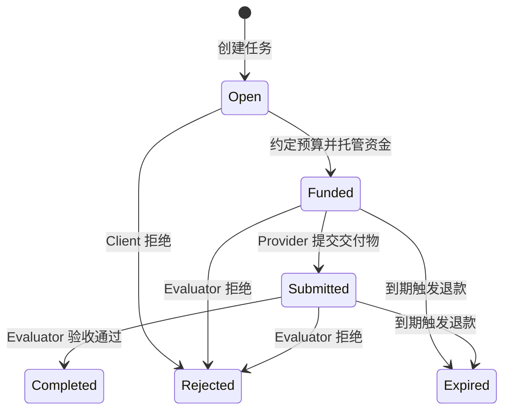

# 常用 ERC / EIP 标准学习整理

整理日期：2026-10-13。面向 DEX、借贷、NFT、钱包及 AI + Web3 开发学习。

> 本文的项目名称用于说明应用场景，并不代表项目的所有版本、合约或网络都实现了对应标准。ERC-8004、ERC-8183 的官方页面在本次核对时均为 Draft，接口应以实施时的规范版本为准。

## 1. 基础概念与总览

**EIP（Ethereum Improvement Proposal）** 是以太坊改进提案体系，涵盖核心协议、网络、接口和应用标准。**ERC（Ethereum Request for Comments）** 是其中面向应用的标准类别，例如代币接口、签名验证和账户抽象。

ERC-20 的规范页面路径为 `eip-20`；这并不意味着 ERC 与 EIP 是两套互不相关的编号。**x402 属于支付协议，不是 ERC / EIP 编号标准。**

| 场景 | 标准 / 协议 | 主要作用 |
| --- | --- | --- |
| DEX（Uniswap） | ERC-20 | 可互换代币、交易资产及部分版本的 LP 份额 |
| DEX（Uniswap） | ERC-2612 | 使用签名设置 ERC-20 授权额度 |
| DEX（Uniswap） | ERC-721 | Uniswap V3 的流动性仓位 NFT |
| DEX（Uniswap） | EIP-712 | Permit、订单等结构化数据签名 |
| 借贷（Aave） | ERC-20 | 存款资产、aToken 及相关代币接口 |
| 借贷（Aave） | ERC-2612 | 支持 Permit 的资产可用于签名授权存款 |
| 借贷 / 收益金库 | ERC-4626 | 统一资产与金库份额的存取、换算接口 |
| 借贷（Aave） | EIP-712 | Permit、信用委托等场景的结构化签名 |
| NFT（OpenSea） | ERC-721、ERC-1155 | 单一 NFT、多类型资产与批量转移 |
| NFT（OpenSea） | ERC-165 | 查询合约支持的接口 |
| NFT（OpenSea） | ERC-2981 | 查询版税接收方和金额 |
| NFT（OpenSea） | ERC-1271 | 验证合约钱包签名 |
| NFT（OpenSea） | EIP-712 | Seaport 等交易协议的订单签名 |
| 钱包（MetaMask 等） | ERC-4337 | 基于 UserOperation 的账户抽象 |
| 钱包（MetaMask 等） | EIP-7702 | 为 EOA 设置代码委托，扩展账户执行能力 |
| AI + Web3 | ERC-8004 | Agent 身份、信誉与验证登记 |
| AI + Web3 | x402 | HTTP 服务中的机器支付 |
| AI + Web3 | ERC-8183 | 任务托管、验收、付款与退款 |

## 2. DEX：Uniswap 相关标准

### 2.1 ERC-20：可互换代币

**解决的问题：** 为同类资产提供统一的余额、转账和授权接口，例如 USDC、治理代币和 LP 代币。

| 核心接口 | 含义 |
| --- | --- |
| `totalSupply()` | 总发行量 |
| `balanceOf(account)` | 查询账户余额 |
| `transfer(to, amount)` | 从调用者向目标账户转账 |
| `approve(spender, amount)` | 设置 spender 的可支配额度 |
| `allowance(owner, spender)` | 查询授权额度 |
| `transferFrom(from, to, amount)` | 在授权允许的范围内转移资产 |

关键事件：`Transfer`、`Approval`。`name`、`symbol`、`decimals` 在原始规范中属于可选元数据，集成时不应默认一定存在。

**Uniswap 中的应用：** 池子中的交易资产通常遵循 ERC-20；原生 ETH 通常通过 WETH 参与相关池子。Uniswap V2 的 LP 份额也是 ERC-20。

**注意：** `approve` 设置额度，不转移资产；授权对象必须是实际需要支出代币的合约。部分代币存在无返回值、转账扣费、余额重基等特殊行为，接入时需要检查兼容性，不能仅凭 ERC-20 接口推断池子可正常支持。

### 2.2 ERC-2612：签名授权 Permit

**解决的问题：** 用户通过链下签名表达 ERC-20 授权，第三方或业务合约可将签名提交上链，减少单独发送 `approve` 交易的需要。

```solidity
function permit(
    address owner,
    address spender,
    uint256 value,
    uint256 deadline,
    uint8 v,
    bytes32 r,
    bytes32 s
) external;

function nonces(address owner) external view returns (uint256);
function DOMAIN_SEPARATOR() external view returns (bytes32);
```

签名消息包含 `owner`、`spender`、`value`、`nonce`、`deadline`，并使用 EIP-712 域隔离。成功执行后更新 allowance 并消耗 nonce。

**典型流程：** 用户签署 Permit → 路由合约调用 `permit` → 在同一业务交易中执行 `transferFrom` 和 Swap。

**注意：** Permit 本身只更新授权，不执行兑换；提交链上交易仍需 Gas，只是用户不一定亲自支付。ERC-20 不强制支持 Permit，DAI 风格 Permit、Uniswap Permit2 与 ERC-2612 也不能视为相同接口。原始 ERC-2612 的 ECDSA 验签不能自动兼容所有 ERC-1271 合约钱包。

### 2.3 ERC-721：流动性仓位 NFT

**解决的问题：** 表示不可互换、可独立追踪的资产，每个 `tokenId` 对应一项资产。

核心接口包括 `ownerOf(tokenId)`、`balanceOf(owner)`、`approve(to, tokenId)`、`setApprovalForAll(operator, approved)`、`transferFrom` 和 `safeTransferFrom`。元数据扩展提供 `tokenURI(tokenId)`。

**Uniswap 中的应用：** Uniswap V3 的 `NonfungiblePositionManager` 使用 ERC-721 表示仓位。仓位包含池子、费率档位、价格区间和流动性等信息，不同仓位不能简单按相同数量互换。

**注意：** 这是仓位管理层的表示方式，不意味着底层池子就是 ERC-721。`tokenURI` 属于元数据扩展；合约接收 NFT 时通常需要实现 `onERC721Received`，安全转移才能成功。

### 2.4 EIP-712：结构化数据签名

**解决的问题：** 为链下结构化数据定义可复现的签名摘要，使钱包可以展示字段，并通过域隔离区分不同应用和网络。

```text
digest = keccak256(
    "\x19\x01" || domainSeparator || hashStruct(message)
)
```

域常见字段包括 `name`、`version`、`chainId`、`verifyingContract`，具体使用哪些字段取决于应用。应用消息可包含授权额度、交易条件、nonce 和截止时间。

**注意：** EIP-712 只规范编码和哈希，不自动提供防重放或业务权限控制。合约仍需校验签名者、nonce、有效期、域和实际交易条件。结构化展示也不代表签名内容一定安全。

## 3. 借贷：Aave 与收益金库相关标准

### 3.1 ERC-20：存款资产与凭证

用户向 Aave 提供 ERC-20 资产，并获得相应 aToken。aToken 采用 ERC-20 接口，余额反映存款及利息累积，具体机制由协议实现。

**基础流程：** 授权资产给 Pool → 调用 `supply` → 获得 aToken → 调用 `withdraw` 取回资产。

**注意：** Aave 的债务代币虽具有相关代币接口，但存在转账和授权限制，不能当作普通自由流通的 ERC-20。能否借款还取决于抵押品配置、价格、健康因子和风险参数。

### 3.2 ERC-2612 与 EIP-712：签名授权和委托

对于支持相应 Permit 接口的底层资产，Aave 的相关入口（例如 V3 的 `supplyWithPermit`）可以组合签名授权与存款，减少用户操作步骤。

EIP-712 也可用于协议定义的签名信用委托：授权其他地址在规定范围内借款。**信用委托与代币 Permit 的授权对象、消息结构和效果不同。**

集成前应确认具体网络、资产、Pool 版本和 ABI；不支持 Permit 的资产仍需要常规授权流程。

### 3.3 ERC-4626：代币化金库

**解决的问题：** 为基于单一 ERC-20 底层资产的金库提供统一接口，区分底层资产 `assets` 与 ERC-20 金库份额 `shares`。

| 核心接口 | 含义 |
| --- | --- |
| `asset()`、`totalAssets()` | 底层资产地址、金库管理的资产总量 |
| `convertToShares(assets)`、`convertToAssets(shares)` | 资产与份额的理想化换算 |
| `deposit(assets, receiver)` | 指定投入资产数量，获得份额 |
| `mint(shares, receiver)` | 指定获得份额数量，投入所需资产 |
| `withdraw(assets, receiver, owner)` | 指定提取资产数量，消耗所需份额 |
| `redeem(shares, receiver, owner)` | 指定赎回份额数量，获得资产 |
| `previewDeposit/Mint/Withdraw/Redeem` | 按当前条件预估相应操作结果 |
| `maxDeposit/Mint/Withdraw/Redeem` | 查询当前操作限制 |

关键事件：`Deposit`、`Withdraw`，以及份额作为 ERC-20 的相关事件。

**与 Aave 的关系：** ERC-4626 金库可以把 Aave 作为底层收益策略，存入资产后向 Aave 提供流动性，再向用户发行标准化份额。**Aave aToken 本身不能直接等同于 ERC-4626 金库。**

**示例：** 金库持有 1,100 USDC，发行 1,000 shares；在忽略费用、舍入和实现细节的情况下，100 shares 约对应 110 USDC。实际应调用标准接口获取换算和预估值。

**注意：** 换算函数与 preview 函数的费用、舍入语义不同；preview 也不能替代 max 限额检查。实际实现需关注流动性不足、捐赠导致的份额价格变化、首存膨胀攻击及滑点保护。标准化接口不保证收益或本金安全。

## 4. NFT：OpenSea 相关标准

### 4.1 ERC-721 与 ERC-1155

| 对比项 | ERC-721 | ERC-1155 |
| --- | --- | --- |
| 资产模型 | 一个 tokenId 对应一个 NFT | 一个合约管理多个资产 ID，每个 ID 可有多份余额 |
| 所有权 / 余额 | `ownerOf(tokenId)` | `balanceOf(account, id)` |
| 转移接口 | `safeTransferFrom` | `safeTransferFrom`、`safeBatchTransferFrom` |
| 授权机制 | 单个 NFT 授权或全部授权 | 核心标准采用 operator 的全部授权 |
| 常见场景 | 艺术品、身份、独立仓位 | 游戏道具、票券、多个版本的收藏品 |

ERC-1155 关键事件包括 `TransferSingle`、`TransferBatch`、`ApprovalForAll`、`URI`。合约接收方需要实现相应接收回调。ERC-1155 不规定必须存在 `totalSupply(id)`，供应量追踪属于常见扩展。

OpenSea 等市场通过这些接口识别资产、展示余额并执行交易转移。NFT 的所有权并不自动包含版权或商业使用权。

### 4.2 ERC-165：接口检测

```solidity
function supportsInterface(bytes4 interfaceId) external view returns (bool);
```

`interfaceId` 通常由接口内函数 selector 异或得到。

| 接口 | 常见 interfaceId |
| --- | --- |
| ERC-165 | `0x01ffc9a7` |
| ERC-721 核心接口 | `0x80ac58cd` |
| ERC-1155 | `0xd9b67a26` |
| ERC-2981 | `0x2a55205a` |

**注意：** 接口声明用于发现能力，不证明合约实现正确或可信。ERC-20 通常不能通过 ERC-165 统一识别。

### 4.3 ERC-2981：NFT 版税查询

```solidity
function royaltyInfo(uint256 tokenId, uint256 salePrice)
    external view returns (address receiver, uint256 royaltyAmount);
```

市场传入 tokenId 和成交价，获得版税接收方与应付金额。例如成交价为 1 ETH、版税比例为 5%，查询结果可返回 0.05 ETH。

**注意：** ERC-2981 提供查询机制，不强制市场付款，也不自动完成结算。版税金额与传入成交价使用同一计价单位；是否执行版税还取决于市场规则和交易协议。

### 4.4 ERC-1271：合约钱包签名验证

```solidity
function isValidSignature(bytes32 hash, bytes memory signature)
    external view returns (bytes4 magicValue);
```

验证成功返回 `0x1626ba7e`。合约钱包可以依据多签、权限模块或其他自定义逻辑决定签名是否有效。

**应用：** NFT 订单由智能合约钱包签署时，交易协议不能只使用 `ecrecover`，而应支持对应的合约验签路径。

**注意：** 合约签名有效性可能随钱包状态变化；函数也可能 revert，调用方需要处理。ERC-1271 验证签名，EIP-712 定义消息摘要，两者职责不同。

### 4.5 EIP-712：NFT 订单签名

Seaport 等协议使用结构化订单，表达出售资产、付款资产、接收方、时间范围和其他交易条件。

**典型流程：** 卖家授权 NFT 转移 → 签署链下订单 → 买家提交订单 → 协议验证签名、订单状态和成交条件 → 原子执行资产交换。

**注意：** 签署订单与授权 NFT 是不同操作。订单本身可能具有资产处置效力；nonce、计数器、取消机制和部分成交规则由交易协议定义，不能只靠 EIP-712 推断。

## 5. 钱包：ERC-4337 与 EIP-7702

### 5.1 ERC-4337：账户抽象

**解决的问题：** 通过智能账户和上层交易处理基础设施，使账户能够使用可编程验证和执行逻辑，而不要求为基本方案修改以太坊共识层。

| 组件 | 职责 |
| --- | --- |
| UserOperation | 描述用户操作、验证数据和相关费用参数 |
| Smart Account | 验证操作并执行调用 |
| Bundler | 收集操作并提交链上交易 |
| EntryPoint | 协调验证、执行和费用结算 |
| Paymaster（可选） | 按策略赞助费用或安排其他付费方式 |
| Factory（按需） | 在账户尚未部署时创建账户 |

**流程：** 构造 UserOperation → 用户签名 → Bundler 提交 → EntryPoint 协调账户验证与执行 → 结算费用。

可用于批量调用、Gas 赞助、自定义验证和恢复机制，但这些功能需要账户合约及配套服务实现，标准并不会自动赋予所有钱包这些能力。

**注意：** UserOperation 不是普通以太坊交易；最终仍由链上交易承载。不同 EntryPoint 版本的数据结构和签名处理可能不同，开发时应匹配 ABI、SDK 和网络部署。代付不意味着 Gas 成本消失。

### 5.2 EIP-7702：EOA 代码委托

**解决的问题：** 让已有 EOA 在保留地址的同时，通过签名授权把执行逻辑委托给指定合约代码。

引入 `0x04` 类型交易及 authorization list。授权处理后，EOA 的代码字段保存 `0xef0100 || delegateAddress` 委托标记；调用该账户时，在该账户的上下文中执行目标代码。

委托代码可以实现批量操作、费用赞助及权限模块，也可以与 ERC-4337 基础设施组合使用。

**关键细节：**

- 委托是持久的，不会在交易结束后自动清除；可以通过后续有效授权修改或清除。
- 授权列表的签名不是普通 EIP-712 Permit 签名，有自己的编码及签名域规则。
- 授权处理后的委托设置不会仅因后续执行 revert 而回滚。
- 会话权限、限额、恢复等由委托实现提供，不是 EIP-7702 自动保证的功能。
- 该机制需要目标链支持；MetaMask 等钱包的实际支持取决于产品版本、网络和具体功能。

### 5.3 两者对比

| 对比项 | ERC-4337 | EIP-7702 |
| --- | --- | --- |
| 层级 | 应用层账户抽象机制 | 核心协议交易与账户执行机制 |
| 核心手段 | UserOperation、EntryPoint、智能账户 | EOA 签名授权代码委托 |
| 是否要求共识层支持新机制 | 基本方案不需要 | 需要网络实现 EIP-7702 |
| 与已有 EOA 地址的关系 | 传统路径使用智能账户；也可组合 7702 | 直接扩展已有 EOA 地址 |
| Gas 赞助 | 可通过 Paymaster 等实现 | 可通过交易发送方和委托逻辑实现 |

二者可以协作：7702 为已有 EOA 提供可编程执行能力，4337 提供操作提交、验证和费用处理的基础设施。

## 6. AI + Web3：身份、支付与任务结算

### 6.1 ERC-8004：Trustless Agents

**定位：** 为跨组织 Agent 的发现与信任提供可组合的链上登记机制。官方页面本次核对为 **Draft**。

| 登记模块 | 作用 |
| --- | --- |
| Identity Registry | 基于 ERC-721 的 Agent 标识及注册文件引用 |
| Reputation Registry | 登记、查询反馈及响应，为信誉分析提供数据 |
| Validation Registry | 登记独立验证请求与验证结果 |

Agent 通过 `agentRegistry + agentId` 标识；`agentURI` 指向注册文件，描述名称、服务端点和支持的信任机制。服务端点可引用 MCP、A2A 等协议。

当前草案代表性操作包括 `register`、`setAgentURI`、`setAgentWallet`、`giveFeedback`、`validationRequest` 和 `validationResponse`。设置新的收款钱包需要证明对钱包的控制，可使用 EIP-712 / ERC-1271 验签。

**注意：** 登记身份不证明 Agent 输出正确；信誉需要防范刷分、女巫攻击和评价来源偏差。验证模块记录验证信号，其可信度仍取决于验证者与验证机制。支付不属于 ERC-8004 的核心范围。

### 6.2 x402：基于 HTTP 402 的支付协议

**定位：** 让客户端或 Agent 在访问 API、数据或其他 HTTP 服务时按协议付费，减少人工开户和支付操作。它可以支持多链、多资产及不同支付方案，具体能力由实现决定。

**典型流程：**

1. Agent 请求受保护的资源。
2. 服务端返回 HTTP `402 Payment Required` 及机器可读支付要求。
3. 客户端选择支持的网络、资产和支付方案，生成支付载荷并重新请求。
4. 服务端自行处理，或通过 facilitator 验证并结算支付。
5. 服务端返回资源以及协议规定的支付结果信息。

不同协议版本的字段和 HTTP 头可能不同，应统一 SDK 和协议版本。支付载荷不一定是已经确认的链上交易，也可能是待验证、待提交结算的签名授权。

**应用：** 按次调用模型 API、付费查询数据、Agent 购买其他 Agent 提供的工具服务。

**注意：** x402 主要解决访问资源时的支付协商和结算衔接；长周期任务的验收、争议处理与退款需要额外机制。服务端仍需处理重复请求、幂等、支付失败和资源交付失败。

### 6.3 ERC-8183：Agentic Commerce

**定位：** 以任务、ERC-20 预算托管及 evaluator 验收为核心，规范 Agent 商务中的条件付款与退款。官方页面本次核对为 **Draft**。

| 角色 | 职责 |
| --- | --- |
| Client | 创建任务、锁定预算，接收拒绝或过期退款 |
| Provider | 承接任务并提交交付物引用，完成后收款 |
| Evaluator | 验收任务，决定完成或拒绝；可以是 Client 或验证合约 |

当前草案定义六种状态：`Open`、`Funded`、`Submitted`、`Completed`、`Rejected`、`Expired`；后三者为终态。



代表性操作包括 `createJob`、`setProvider`、`setBudget`、`fund`、`submit`、`complete`、`reject`、`claimRefund`。这些是操作名称，具体参数与可选 Hook 扩展应以草案和部署 ABI 为准。

完成时向 Provider 释放资金，可扣除实现定义的平台费用；拒绝或过期时向 Client 退款。过期通常需要调用 `claimRefund` 触发，不会仅因时间经过自动执行链上转账。Provider 只提交任务，不能自行宣告验收完成。

**注意：** 任务交付物引用或哈希不证明结果正确，Evaluator 的选择影响信任模型。核心机制不自动包含复杂仲裁。草案的可选 Hook 可扩展业务，但过期退款路径不应被 Hook 阻断。

### 6.4 三者如何组合

| 层次 | 协议 | 回答的问题 |
| --- | --- | --- |
| 发现与信任 | ERC-8004 | Agent 是谁？如何发现？有哪些评价和验证记录？ |
| 即时服务支付 | x402 | 调用这个 API 或工具需要如何付款？ |
| 条件任务结算 | ERC-8183 | 任务资金如何托管？谁验收？何时付款或退款？ |

**示例：** 用户通过 ERC-8004 发现研究 Agent → 使用 ERC-8183 创建研究任务并托管预算 → Agent 使用 x402 购买数据 API → 提交报告引用 → Evaluator 验收 → 释放任务资金，并将相关反馈登记到信誉系统。

这种组合是应用设计示例，不是三个协议强制要求的调用链。

## 7. 学习与实践建议

| 阶段 | 学习内容 | 建议实践 |
| --- | --- | --- |
| 基础资产 | ERC-20、ERC-721、ERC-1155、ERC-165 | 部署代币与 NFT，测试授权、转移和接收回调 |
| 签名机制 | EIP-712、ERC-2612、ERC-1271 | 构造 Permit，验证重放、过期和合约钱包签名 |
| DeFi | ERC-4626、DEX 与借贷集成 | 比较 assets / shares，模拟存取与收益变化 |
| NFT 交易 | ERC-2981、结构化订单 | 查询版税，理解授权、签名和成交的区别 |
| 账户抽象 | ERC-4337、EIP-7702 | 理解操作提交、代码委托及费用赞助 |
| Agent 商务 | ERC-8004、x402、ERC-8183 | 串联发现、付费工具调用、托管任务和验收 |

应能清楚解释：`approve` 与 `permit` 的区别、EIP-712 为什么仍需业务防重放、aToken 为什么不等于 ERC-4626、版税查询为什么不保证支付，以及 Agent 登记和验收为什么不自动证明输出可信。

## 8. 官方规范与参考资料

### ERC / EIP 规范

- [ERC-20：Token Standard](https://eips.ethereum.org/EIPS/eip-20)
- [ERC-2612：Permit Extension](https://eips.ethereum.org/EIPS/eip-2612)
- [ERC-721：Non-Fungible Token Standard](https://eips.ethereum.org/EIPS/eip-721)
- [EIP-712：Typed Structured Data Hashing and Signing](https://eips.ethereum.org/EIPS/eip-712)
- [ERC-4626：Tokenized Vaults](https://eips.ethereum.org/EIPS/eip-4626)
- [ERC-1155：Multi Token Standard](https://eips.ethereum.org/EIPS/eip-1155)
- [ERC-165：Standard Interface Detection](https://eips.ethereum.org/EIPS/eip-165)
- [ERC-2981：NFT Royalty Standard](https://eips.ethereum.org/EIPS/eip-2981)
- [ERC-1271：Standard Signature Validation Method for Contracts](https://eips.ethereum.org/EIPS/eip-1271)
- [ERC-4337：Account Abstraction Using Alt Mempool](https://eips.ethereum.org/EIPS/eip-4337)
- [EIP-7702：Set Code for EOAs](https://eips.ethereum.org/EIPS/eip-7702)
- [ERC-8004：Trustless Agents（Draft）](https://eips.ethereum.org/EIPS/eip-8004)
- [ERC-8183：Agentic Commerce（Draft）](https://eips.ethereum.org/EIPS/eip-8183)

### 项目文档

- [Uniswap 文档](https://docs.uniswap.org/)
- [Aave 文档](https://aave.com/docs)
- [OpenSea / Seaport 文档](https://docs.opensea.io/)
- [MetaMask 开发者文档](https://docs.metamask.io/)
- [x402 官网](https://www.x402.org/)
- [x402 协议与实现仓库](https://github.com/coinbase/x402)

资料核对范围：本次直接读取了 ERC-8004、ERC-8183、EIP-7702 的官方规范页面及 x402 官网；其余链接提供规范与项目实现的进一步查阅入口。
